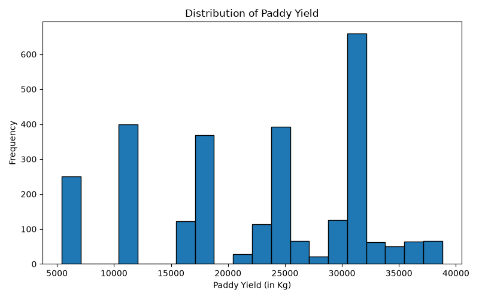
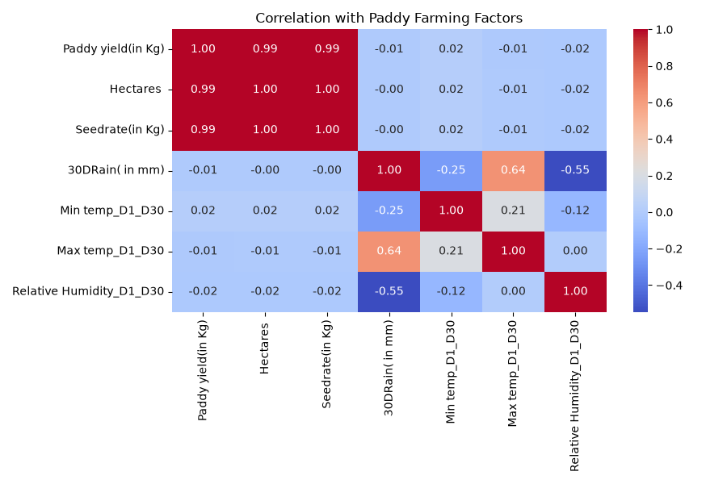
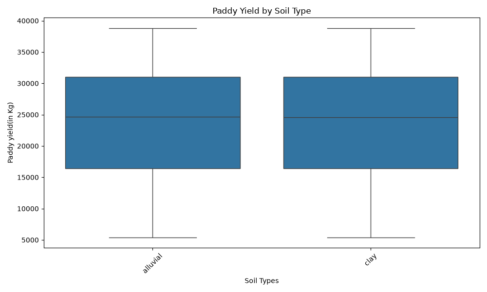
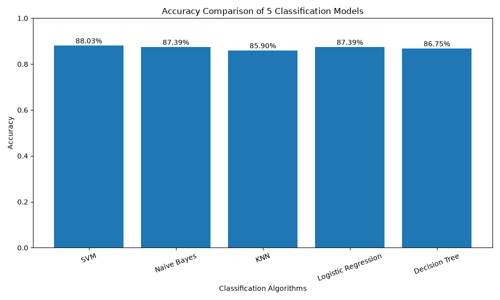

# 🌾 Paddy Yield Prediction Using Machine Learning


## 📌 Project Overview

Paddy Yield Prediction is a Machine Learning classification project designed to predict the yield category of paddy crops based on agricultural and environmental factors.

The project uses multiple classification algorithms and compares their performance to identify the most suitable model for predicting paddy yield categories.

The prediction classes are:
- **Low Yield**
- **Medium Yield**
- **High Yield**

## 🎯 Problem Statement

Agricultural yield depends on several factors, including soil conditions, crop variety, weather conditions, and other farming parameters.

This project aims to analyze these factors using Machine Learning and classify paddy yield into three categories: Low, Medium, and High.

## 🎯 Project Objectives

- Perform Exploratory Data Analysis (EDA).
- Identify important agricultural and environmental features.
- Handle duplicate records and preprocess the dataset.
- Apply multiple Machine Learning classification algorithms.
- Compare model performance using evaluation metrics.
- Select the best-performing classification model.

## 🛠️ Technologies Used

- Python
- Pandas
- NumPy
- Matplotlib
- Seaborn
- Scikit-learn
- Imbalanced-learn (if used in the final code)

## 📂 Dataset Information

- Initial dataset records: 2,789
- Records after duplicate removal: 2,338
- Features: 44
- Target: Paddy Yield Category

The dataset contains agricultural information such as:
- Agricultural block
- Paddy variety
- Soil type
- Nursery information
- Wind direction
- Other agricultural parameters

**Dataset Source:** The original dataset source and attribution should be added here after verification.

## ⚙️ Machine Learning Algorithms

The project evaluates the following classification algorithms:

1. Logistic Regression
2. Decision Tree
3. Random Forest
4. Support Vector Machine (SVM)
5. K-Nearest Neighbors (KNN)
6. Naive Bayes

## 📊 Model Performance

The following are the currently recorded results:

| Model | Accuracy |
|---|---:|
| Logistic Regression | 87.39% |
| Decision Tree | 86.75% |
| Random Forest | 85.90% |

**Best Performing Model:** Logistic Regression

### Evaluation Metrics

- Accuracy
- Precision
- Recall
- F1-Score
- Confusion Matrix

## 📈 Exploratory Data Analysis

The project includes visualizations for understanding the dataset, agricultural features, and classification results.

## 🚀 How to Run the Project

### 1. Clone the repository

```bash
git clone https://github.com/abhirana270/Paddy-Yield-Prediction-ML.git
```

### 2. Open the project folder

```bash
cd Paddy-Yield-Prediction-ML
```

### 3. Install dependencies

```bash
pip install pandas numpy matplotlib seaborn scikit-learn imbalanced-learn
```

### 4. Run the Python file

```bash
python paddy_project.py
```

Make sure the dataset file is available in the project directory.

## 📁 Repository Structure

```text
Paddy-Yield-Prediction-ML/
│
├── paddy_project.py
├── paddydataset.csv
├── Figure_1.png
├── Figure_2.png
├── Figure_3.png
├── Figure_4_confuson matr.png
├── Figure_7.png
├── .gitignore
└── README.md
```

## 🔮 Future Improvements

- Develop an interactive web application.
- Allow users to enter agricultural parameters manually.
- Provide real-time yield category predictions.
- Improve model performance using additional agricultural data.
- Deploy the trained model for practical use.

## 👨‍💻 Author

**Abhishek Rana**

B.Tech – Computer Science and Engineering  
Lovely Professional University

GitHub: [@abhirana270](https://github.com/abhirana270)

---

## 📊 Project Visualizations

### Exploratory Data Analysis







### Confusion Matrix


### Classification Algorithm Comparison




⭐ If you find this project interesting, consider giving the repository a star!
